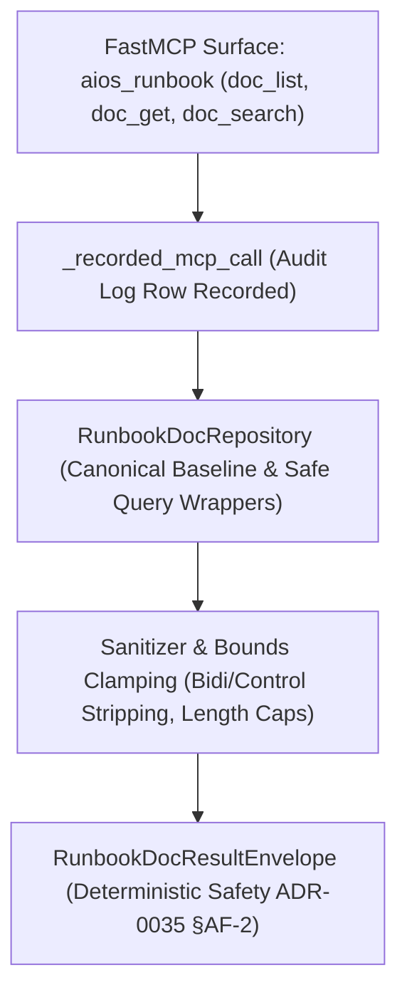

# Specification: Incident Response Runbooks Documentation Subsystem (SPEC-INCIDENT-RUNBOOK-DOCUMENTATION)

- **Status**: SHIPPED
- **Date**: 2026-10-16
- **Subsystem**: Phase 2 Security Kernel & PEP Fabric / Incident Response Runbooks / documentation
- **Binding**: NIST SP 800-61 Rev. 2, CISA Playbooks, ADR-0035 §AF-2, Proof-of-Restraint (PoR) Invariant I-2
- **Shipped Implementations**:
  - Rust Core Substrate: `code/aiosh-rust/aiosh-core/src/incident_runbook_doc.rs`
  - Python MCP Fabric: `code/aiosh-mcp/aiosh_mcp/incident_runbook_doc.py`
  - FastMCP Tool Surface: `code/aiosh-mcp/aiosh_mcp/incident_runbook_mcp.py` (`action="doc_list"`, `"doc_get"`, `"doc_search"`)
- **Evidence Trail**:
  - Research: [T-03043-documentation-research.md](tasks/evidence/T-03043-documentation-research.md)
  - Specification: [T-03044-spec.md](tasks/evidence/T-03044-spec.md)
  - Scaffold: [T-03045-documentation-scaffold.md](tasks/evidence/T-03045-documentation-scaffold.md)
  - Implementation: [T-03046-documentation-implementation.md](tasks/evidence/T-03046-documentation-implementation.md)
  - Unit Tests: [T-03047-documentation-unit.md](tasks/evidence/T-03047-documentation-unit.md)
  - Integration: [T-03048-documentation-integration.md](tasks/evidence/T-03048-documentation-integration.md)
  - Security Review: [T-03049-documentation-security-review.md](tasks/evidence/T-03049-documentation-security-review.md)
  - Hardening: [T-03050-documentation-hardening.md](tasks/evidence/T-03050-documentation-hardening.md)

---

## 1. Subsystem Architecture

The Incident Response Runbooks Documentation subsystem provides an offline, self-contained reference repository and ranked search engine for operators, agents, and auditors. It covers incident response playbooks, execution state machine rules, diagnostic scanning parameters, security policies, and telemetry models.



---

## 2. Topic Data Model & Schemas

### `RunbookDocTopic`
| Field | Type | Description |
|:---|:---|:---|
| `id` | `String` / `str` | Strict canonical identifier (e.g. `runbook.arch.overview`). Validated against traversal. |
| `title` | `String` / `str` | Descriptive human-readable title. |
| `category` | `RunbookDocCategory` | Categorical classification: `architecture`, `datamodel`, `lifecycle`, `security_tools`, `policy`, `observability`, `recovery`. |
| `summary` | `String` / `str` | High-level summary text (bounded to 8192 chars). |
| `sections` | `Vec<RunbookDocSection>` | Structured sections containing section title and markdown content. |
| `related_topics`| `Vec<String>` | Cross-reference links to related canonical topics. |

### `RunbookDocSearchResult`
| Field | Type | Description |
|:---|:---|:---|
| `topic_id` | `String` / `str` | Matched topic identifier. |
| `title` | `String` / `str` | Matched topic title. |
| `category` | `RunbookDocCategory` | Topic category. |
| `score` | `usize` / `int` | Weighted match score: ID match (+15), Title match (+10), Summary (+5), Section Title (+3), Section Text (+1). |
| `snippet` | `String` / `str` | Contextual text snippet capped to 200 characters. |

---

## 3. FastMCP Invocations & Copy-Pasteable Examples

All documentation queries are routed through the unified `aios_runbook` FastMCP tool under the `_recorded_mcp_call` audit framework.

### Example 1: Listing Documentation Topics
```json
{
  "name": "aios_runbook",
  "arguments": {
    "action": "doc_list",
    "category": "security_tools"
  }
}
```

### Example 2: Retrieving a Topic
```json
{
  "name": "aios_runbook",
  "arguments": {
    "action": "doc_get",
    "runbook_id": "runbook.tools.scanning"
  }
}
```

### Example 3: Searching Documentation
```json
{
  "name": "aios_runbook",
  "arguments": {
    "action": "doc_search",
    "parameters": {
      "query": "RustSec port scan"
    }
  }
}
```

### Python Direct SDK Invocation
```python
from aiosh_mcp.incident_runbook_mcp import execute_runbook_action

# Execute search through audit gate
result = execute_runbook_action(
    action="doc_search",
    parameters={"query": "observability metrics"},
)
print(f"Status: {result['ok']}, Hits: {len(result['results'])}, Audit ID: {result['audit_id']}")
```

---

## 4. Hardening Invariants & Result Envelope

Following ADR-0035 §AF-2, operations return a standardized result envelope:

```rust
pub struct RunbookDocResultEnvelope<T> {
    pub ok: bool,
    pub data: Option<T>,
    pub error_code: Option<String>,
    pub error_message: Option<String>,
    pub audit_row_required: bool,
}
```

- **Fail-Safe & Honest Logging**: Queries violating input constraints do not panic or crash the runtime. Instead, an error envelope is produced, and an honest audit row is committed to the tamper-evident log ring.

---

## 5. Constraints & Known Limitations

1. **In-Memory Volatility**:
   - The documentation repository runs entirely in-memory for zero external dependencies and fast offline lookups. Dynamically added topics (`add_topic_safe`) do not persist across daemon restarts. Canonical reference topics are automatically loaded upon startup.
2. **Query Bounds**:
   - Search queries are limited to `MAX_RUNBOOK_DOC_QUERY_LEN = 128` characters. Queries exceeding this limit fail with `IRDOC_ERR_QUERY_BOUNDS`.
3. **Capacity Caps**:
   - Maximum registered topics: `MAX_RUNBOOK_DOC_TOPICS_COUNT = 256`.
   - Maximum text length per field: `MAX_RUNBOOK_DOC_TEXT_LEN = 8192` characters.
4. **Result Truncation**:
   - Search returns at most `MAX_RUNBOOK_DOC_SEARCH_RESULTS = 10` top-scored results.
   - Text snippets are clamped to `MAX_RUNBOOK_DOC_SNIPPET_LEN = 200` characters.
5. **Bidirectional & Control Sanitization**:
   - Zero-width codepoints and bidirectional Unicode overrides (`U+202A..U+202E`, `U+200B..U+200F`, `U+FEFF`) are stripped prior to search evaluation.
