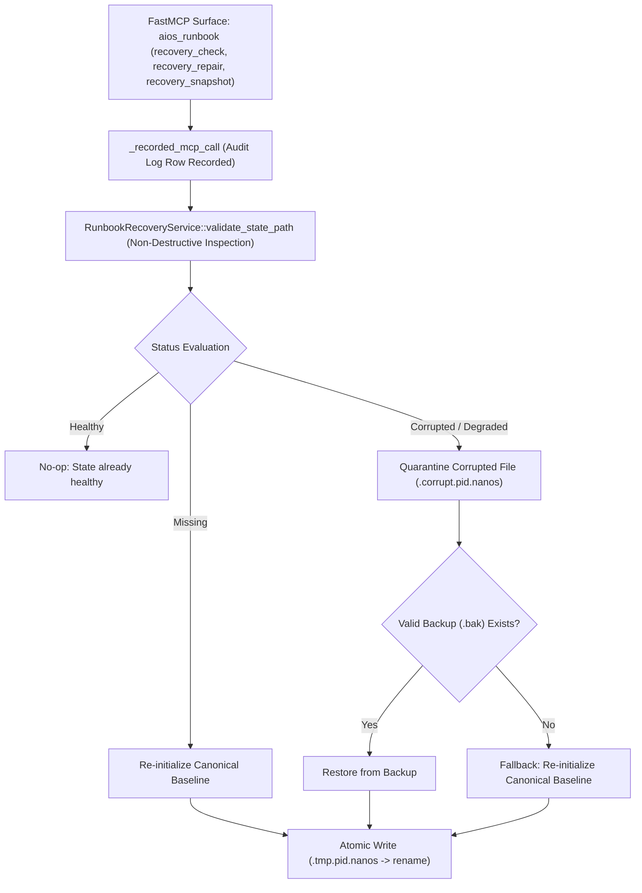

# Specification: Incident Response Runbooks Recovery & Validation Subsystem (SPEC-INCIDENT-RUNBOOK-RECOVERY)

- **Status**: SHIPPED
- **Date**: 2026-10-17
- **Subsystem**: Phase 2 Security Kernel & PEP Fabric / Incident Response Runbooks / recovery & validation
- **Binding**: NIST SP 800-61 Rev. 2 §3.4, CISA Playbooks, ADR-0035 §AF-2, Proof-of-Restraint (PoR) Invariant I-2
- **Shipped Implementations**:
  - Rust Core Substrate: `code/aiosh-rust/aiosh-core/src/incident_runbook_recovery.rs`
  - Python MCP Fabric: `code/aiosh-mcp/aiosh_mcp/incident_runbook_recovery.py`
  - FastMCP Tool Surface: `code/aiosh-mcp/aiosh_mcp/incident_runbook_mcp.py` (`action="recovery_check"`, `"recovery_repair"`, `"recovery_snapshot"`)
- **Evidence Trail**:
  - Research: [T-03053-recovery-validation-research.md](tasks/evidence/T-03053-recovery-validation-research.md)
  - Specification: [T-03054-spec.md](tasks/evidence/T-03054-spec.md)
  - Scaffold: [T-03055-recovery-validation-scaffold.md](tasks/evidence/T-03055-recovery-validation-scaffold.md)
  - Implementation: [T-03056-recovery-validation-implementation.md](tasks/evidence/T-03056-recovery-validation-implementation.md)
  - Unit Tests: [T-03057-recovery-validation-unit-test.md](tasks/evidence/T-03057-recovery-validation-unit-test.md)
  - Integration: [T-03058-recovery-validation-integration.md](tasks/evidence/T-03058-recovery-validation-integration.md)
  - Security Review: [T-03059-recovery-validation-security-review.md](tasks/evidence/T-03059-recovery-validation-security-review.md)
  - Hardening: [T-03060-recovery-validation-hardening.md](tasks/evidence/T-03060-recovery-validation-hardening.md)

---

## 1. Subsystem Architecture

The Incident Response Runbooks Recovery & Validation subsystem protects runtime runbook catalogs, active incident sessions, and configuration stores against crashes, torn writes, data corruption, and disk exhaustion.



---

## 2. Data Models & Schemas

### `RunbookCatalogStatus`
- `healthy`: State file exists, schema is valid, step targets and parameters verified, no duplicates.
- `degraded`: State file readable with non-critical warnings (e.g. duplicate IDs or step validation issues).
- `corrupted`: Unparseable JSON, oversized file, path traversal, or schema violation.
- `missing`: Target file does not exist on disk.

### `RunbookValidationReport`
| Field | Type | Description |
|:---|:---|:---|
| `status` | `RunbookCatalogStatus` | Catalog health classification. |
| `checked_at_utc` | `String` (ISO 8601) | Timestamp of inspection. |
| `target_path` | `String` | Inspected file path. |
| `issues` | `Vec<RunbookValidationIssue>` | List of detected validation issues. |
| `total_runbooks` | `usize` | Number of registered runbooks. |
| `total_active_sessions` | `usize` | Number of active sessions. |
| `is_recoverable` | `bool` | True if repair can restore operational state. |

### `RunbookRecoveryReport`
| Field | Type | Description |
|:---|:---|:---|
| `ok` | `bool` | True if repair/restore succeeded. |
| `recovered_at_utc` | `String` (ISO 8601) | Recovery timestamp. |
| `quarantine_path` | `Option<String>` | Location of quarantined corrupt file, if any. |
| `backup_path` | `Option<String>` | Location of restored backup, if any. |
| `restored_runbooks_count` | `usize` | Number of runbooks active after recovery. |
| `action_taken` | `String` | Recovery action: `noop`, `canonical_reinitialized`, `backup_restored`. |

---

## 3. FastMCP Invocations & Copy-Pasteable Examples

All recovery operations are invoked via `aios_runbook` behind the `_recorded_mcp_call` audit framework.

### Example 1: Non-Destructive Integrity Check
```json
{
  "name": "aios_runbook",
  "arguments": {
    "action": "recovery_check",
    "parameters": {
      "path": "runbook_state.json"
    }
  }
}
```

### Example 2: Creating a Snapshot Backup
```json
{
  "name": "aios_runbook",
  "arguments": {
    "action": "recovery_snapshot",
    "parameters": {
      "path": "runbook_state.json"
    }
  }
}
```

### Example 3: Repairing Corrupted State
```json
{
  "name": "aios_runbook",
  "arguments": {
    "action": "recovery_repair",
    "parameters": {
      "path": "runbook_state.json"
    }
  }
}
```

### Python Direct SDK Invocation
```python
from aiosh_mcp.incident_runbook_mcp import execute_runbook_action

# Execute recovery repair through audit gate
result = execute_runbook_action(
    action="recovery_repair",
    parameters={"path": "runbook_state.json"},
)
print(f"Status: {result['ok']}, Action: {result['report']['action_taken']}, Audit ID: {result['audit_id']}")
```

---

## 4. Hardening Invariants & Result Envelope

- **Atomic Replacement**: Temporary files are written as `.{name}.tmp.{pid}.{nanos}` in the same directory and swapped via `rename(2)` with `sync_all` to prevent torn writes.
- **Forensic Quarantine**: Damaged files are copied to `.corrupt.{pid}.{nanos}` before restoration.
- **Bounded Footprint**: Old quarantine files exceeding `MAX_QUARANTINE_FILES = 10` are pruned automatically.
- **Standard Envelope**: All service operations return `RunbookRecoveryResultEnvelope` complying with ADR-0035 §AF-2.

---

## 5. Constraints & Known Limitations

1. **Same-Filesystem Mount Required**:
   - Atomic replacement via `rename` requires that temporary files and target files reside on the same filesystem. Cross-device renames are prohibited.
2. **State File Size Cap**:
   - State files exceeding `MAX_RUNBOOK_STATE_SIZE = 10 MiB` are immediately flagged as `Corrupted` (`OversizedPayload`) to prevent memory exhaustion.
3. **Quarantine Retention Limit**:
   - Maximum 10 quarantine files are retained; older quarantine files are pruned chronologically.
4. **Path Traversal Restrictions**:
   - Paths containing `..`, control characters, or null bytes are rejected outright with `IRREC_ERR_PATH_TRAVERSAL`.
